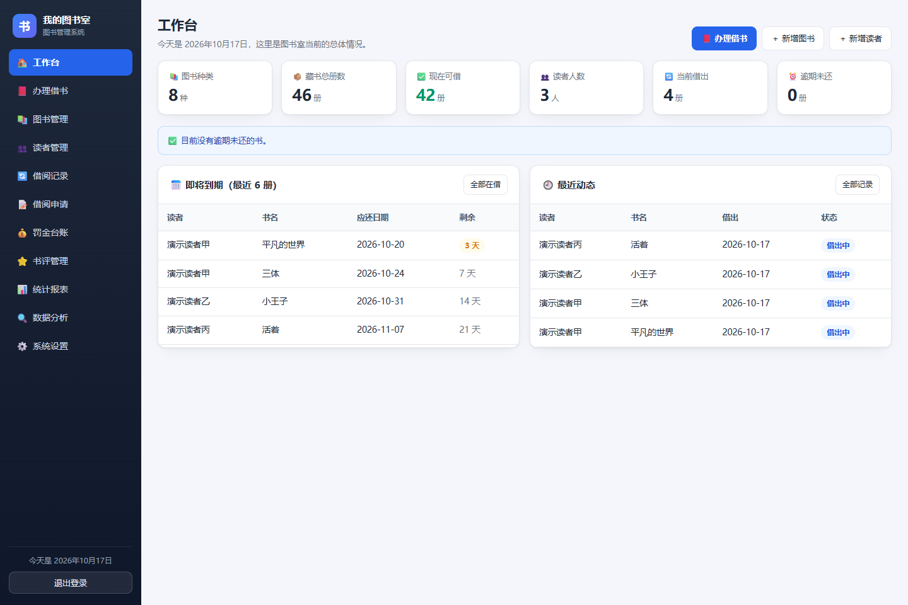

<div align="center">


# 图书管理系统

**让每一本书的借还都有迹可循，让图书室的日常管理更轻松。**

面向学校、社区和企业阅览室的 Java 图书管理系统，提供管理员端与读者端，覆盖馆藏管理、借阅流转和读者自助服务。

[](https://github.com/12122-s/booksysteam/actions/workflows/ci.yml) [](https://openjdk.org/projects/jdk/17/) [](https://spring.io/projects/spring-boot) [](https://www.mysql.com/)

[功能一览](#功能一览) · [快速开始](#快速开始) · [服务器部署](docs/服务器部署说明.md) · [问题反馈](https://github.com/12122-s/booksysteam/issues)

</div>

## 项目亮点

- **双端协同**：管理员处理馆藏、读者与借还，读者在线找书、办卡、申请借阅和查看记录。
- **借阅流程完整**：从借出、续借、归还，到预约排队、逾期提醒和罚金登记，覆盖图书室日常业务。
- **启动即可初始化**：自动建库、建表与补充字段，首次运行无需手动导入 SQL。
- **部署简单**：服务端渲染页面，无需单独构建前端；一个可执行 JAR 即可运行。

## 管理员工作台

登录后集中查看馆藏库存、当前借阅、即将到期与最近动态。以下为实际运行页面，图中使用演示数据。



## 功能一览

| 业务 | 管理员端 | 读者端 |
| --- | --- | --- |
| 馆藏与检索 | 图书档案、分类、库存、封面、批量导入导出 | 按书名、作者等检索，查看库存、位置与图书推荐 |
| 读者服务 | 读者档案、办卡审核、密码重置 | 自助办卡，卡号或手机号登录，资料维护与找回密码 |
| 借阅流转 | 办理借出、归还、续借，处理借阅申请与预约排队 | 申请借阅、续借，查看当前借阅与历史记录 |
| 逾期与罚金 | 到期提醒、罚金台账、缴费申请处理 | 查看到期情况与罚金，提交在线缴费申请 |
| 图书评价 | 书评管理 | 阅读评价、撰写书评 |
| 运营与维护 | 统计报表、数据分析、操作日志、单据打印、备份与恢复 | 查看公告与借阅规则 |

> 借期、可借册数、续借次数、罚金标准，以及是否允许自助办卡、自助借书和是否需要审核，均可在系统设置中调整。

## 快速开始

### 1. 准备环境

| 依赖 | 要求 |
| --- | --- |
| Java | JDK 17，确保 `java -version` 能正常显示版本 |
| 数据库 | MySQL 8，已启动并准备好账号、密码 |
| 构建工具 | 使用仓库自带的 Maven Wrapper，无需另装 Maven |

### 2. 获取项目

```bash
git clone https://github.com/12122-s/booksysteam.git
cd booksysteam
```

也可以在仓库页面点击 **Code → Download ZIP**，解压后在项目根目录打开终端。

### 3. 配置数据库

默认连接 `127.0.0.1:3306`，账号 `root`，密码 `123456`，库名 `library_system`。如果你的 MySQL 配置不同，请在**启动应用的同一个终端**设置环境变量：

**Windows · PowerShell**

```powershell
$env:LIB_DB_USER = "root"
$env:LIB_DB_PASSWORD = "你的数据库密码"
```

**Linux / macOS**

```bash
export LIB_DB_USER="root"
export LIB_DB_PASSWORD="你的数据库密码"
```

应用会自动创建数据库和数据表，请确保数据库账号具有对应权限。其他连接参数见[配置参考](#配置参考)。

### 4. 启动并访问

**Windows · PowerShell**

```powershell
.\mvnw.cmd spring-boot:run
```

**Linux / macOS**

```bash
chmod +x mvnw
./mvnw spring-boot:run
```

首次运行需要联网下载 Maven 和项目依赖。启动完成后，浏览器打开 [http://localhost:8080](http://localhost:8080)。

| 入口 | 说明 |
| --- | --- |
| 管理员登录 | 账号 `admin`，初始密码 `123456` |
| 读者办卡 | 在登录页点击「我要办卡（新读者注册）」 |
| 已有借书卡 | 点击「我已有卡号，设置网上密码」 |
| 健康检查 | 打开 [http://localhost:8080/health](http://localhost:8080/health)，正常返回 `ok` |

> [!IMPORTANT]
> 初始管理员密码和数据库默认密码均为开发用公开值。首次登录后请立即修改管理员密码；生产部署必须更换数据库密码与 JWT 密钥。

### 5. 体验核心流程

1. 使用管理员账号登录，在「图书管理」中新增一本图书并设置库存。
2. 退出登录，在登录页自助办卡；如启用了办卡审核，由管理员审核通过。
3. 使用读者账号登录，在「找书 / 借书」中申请借阅。
4. 管理员在「借阅申请」中办理借出，再到「借阅记录」中办理续借或归还。

## 打包与部署

在项目根目录执行以下命令，运行测试并生成可执行 JAR：

```powershell
# Windows · PowerShell
.\mvnw.cmd verify
```

```bash
# Linux / macOS
./mvnw verify
```

使用相同的数据库环境变量运行：

```bash
java -jar target/booksysteam-1.0.0.jar
```

JAR 自带 Tomcat，服务器只需安装 Java 17 运行环境和 MySQL 8。完整的上传、启动、systemd 开机自启及 nginx 反向代理步骤，见 **[服务器部署说明](docs/服务器部署说明.md)**；配套脚本见 [deploy/start.sh](deploy/start.sh)。

## 技术栈

| 层次 | 方案 |
| --- | --- |
| 语言与框架 | Java 17、Spring Boot 3.3、Spring MVC |
| 页面 | Thymeleaf 服务端渲染、原生 CSS 与 JavaScript |
| 数据访问 | Spring JDBC（JdbcTemplate）与手写 SQL |
| 数据库 | MySQL 8，`utf8mb4` 编码，启动时自动初始化 |
| 认证 | 页面会话与 CSRF；REST API 使用 JWT |
| 数据与邮件 | Apache POI、Spring Mail，SMTP 参数可在页面配置 |
| API 文档 | springdoc-openapi / Swagger UI |
| 部署与检查 | 可执行 JAR、systemd、nginx、GitHub Actions |

## 配置参考

连接与认证配置见 [application.yml](src/main/resources/application.yml)，可通过环境变量覆盖：

| 环境变量 | 默认值 | 说明 |
| --- | --- | --- |
| `LIB_DB_HOST` | `127.0.0.1` | MySQL 主机 |
| `LIB_DB_PORT` | `3306` | MySQL 端口 |
| `LIB_DB_USER` | `root` | 数据库账号 |
| `LIB_DB_PASSWORD` | `123456` | 数据库密码，**生产环境必须更换** |
| `LIB_DB_NAME` | `library_system` | 数据库名 |
| `SERVER_PORT` | `8080` | 应用 HTTP 端口 |
| `LIB_JWT_SECRET` | 内置开发值 | JWT 签名密钥，**生产环境必须设置为至少 32 个字符的随机值** |
| `LIB_JWT_TTL_MINUTES` | `120` | JWT 有效期，单位为分钟 |

上传目录 `uploads/` 和备份目录 `backups/` 位于**进程工作目录**下。使用 systemd 时请正确设置 `WorkingDirectory`，并确保应用用户有读写权限。

## REST API

API 与页面共用业务服务层。启动应用后打开 [Swagger UI](http://localhost:8080/swagger-ui.html)，先调用登录接口取得 token，再在 **Authorize** 中填写 token。

<details>
<summary><strong>查看主要接口</strong></summary>

| 方法 | 路径 | 身份 | 说明 |
| --- | --- | --- | --- |
| `POST` | `/api/v1/auth/login` | 公开 | 管理员或读者登录，获取 token |
| `GET` | `/api/v1/me` | 登录用户 | 当前身份 |
| `GET` | `/api/v1/books`、`/api/v1/books/{id}` | 登录用户 | 图书列表与详情 |
| `GET` | `/api/v1/readers` | 管理员 | 读者列表 |
| `GET` | `/api/v1/borrows` | 管理员 | 借阅记录 |
| `POST` | `/api/v1/borrows` | 管理员 | 办理借出 |
| `POST` | `/api/v1/borrows/{id}/return` | 管理员 | 办理归还 |
| `POST` | `/api/v1/borrows/{id}/renew` | 管理员 | 办理续借 |
| `GET` | `/api/v1/stats/overview` | 管理员 | 库存与罚金总览 |

</details>

## 测试与持续集成

| 检查 | 数量 | 覆盖范围 |
| --- | --- | --- |
| 单元测试 | 43 项 | 密码哈希、日期容错、CSV 与 SQL 转义、JWT、登录限流、借阅规则、并发库存扣减、数据库地址解析 |
| 冒烟测试 | 39 项 | 登录、管理页面、导出、公开页面及 REST API 鉴权与主要端点 |
| 读者端全流程 | 22 项 | 办卡、登录、找书、申请借阅、续借、书评与归还 |

单元测试不依赖数据库，可直接运行：

```powershell
# Windows · PowerShell
.\mvnw.cmd test
```

```bash
# Linux / macOS
./mvnw test
```

推送到 `main` 或提交 Pull Request 后，[GitHub Actions](https://github.com/12122-s/booksysteam/actions/workflows/ci.yml) 会运行单元测试，并启动 MySQL 8 执行两组端到端检查。检查脚本见 [tests/](tests)。

## 项目结构

```text
src/main/java/com/library/
├── config/          数据库初始化与 OpenAPI 配置
├── controller/      页面控制器，api/ 下提供 REST API v1
├── service/         借阅、罚金、提醒、备份与导入等业务
├── dao/             JdbcTemplate 数据访问
├── entity/          实体对象
├── dto/             表单与传输对象
├── web/             拦截器、CSRF、模板变量与错误处理
└── util/            密码、日期、JWT、CSV、SQL 与缓存工具
src/main/resources/  应用配置、Thymeleaf 模板与静态资源
src/test/java/       Java 单元测试
tests/               Python 冒烟与读者端流程检查
docs/                服务器部署说明
deploy/              Linux 启停脚本
```

## 使用与维护

- **首次使用**：修改管理员密码，检查系统设置中的借期、可借册数与罚金标准。
- **单实例运行**：定时提醒和自动备份随应用进程运行，同一套数据库请只运行一个实例。
- **数据迁移**：在系统设置中导出完整备份，再在新环境通过恢复功能导入。
- **问题反馈**：在 [Issues](https://github.com/12122-s/booksysteam/issues) 中附上复现步骤、运行环境和相关错误日志；提交前请移除密码、密钥及个人信息。

<div align="center">

[返回顶部](#图书管理系统)

</div>
